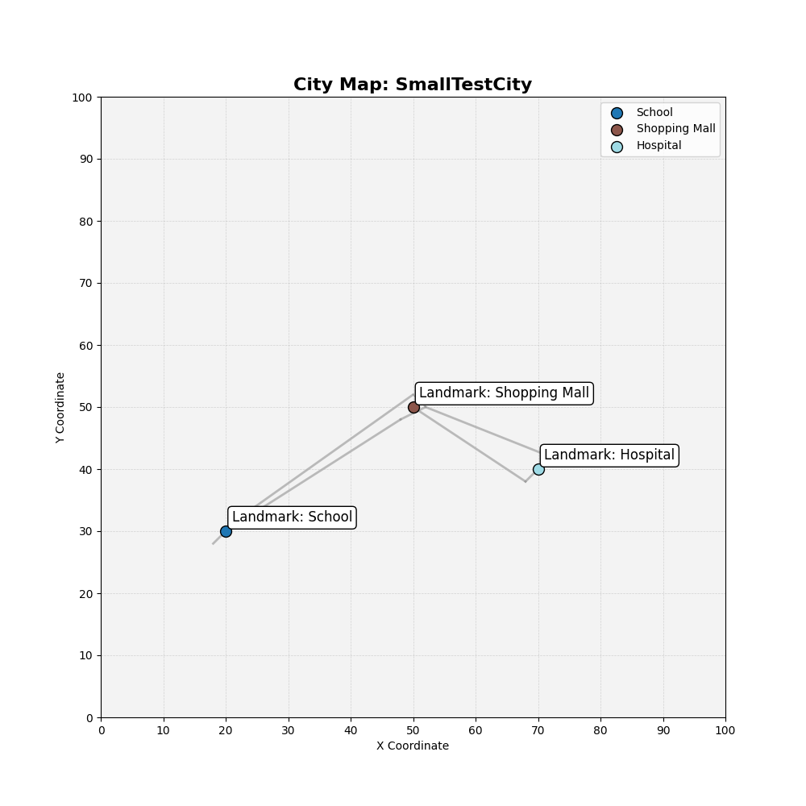
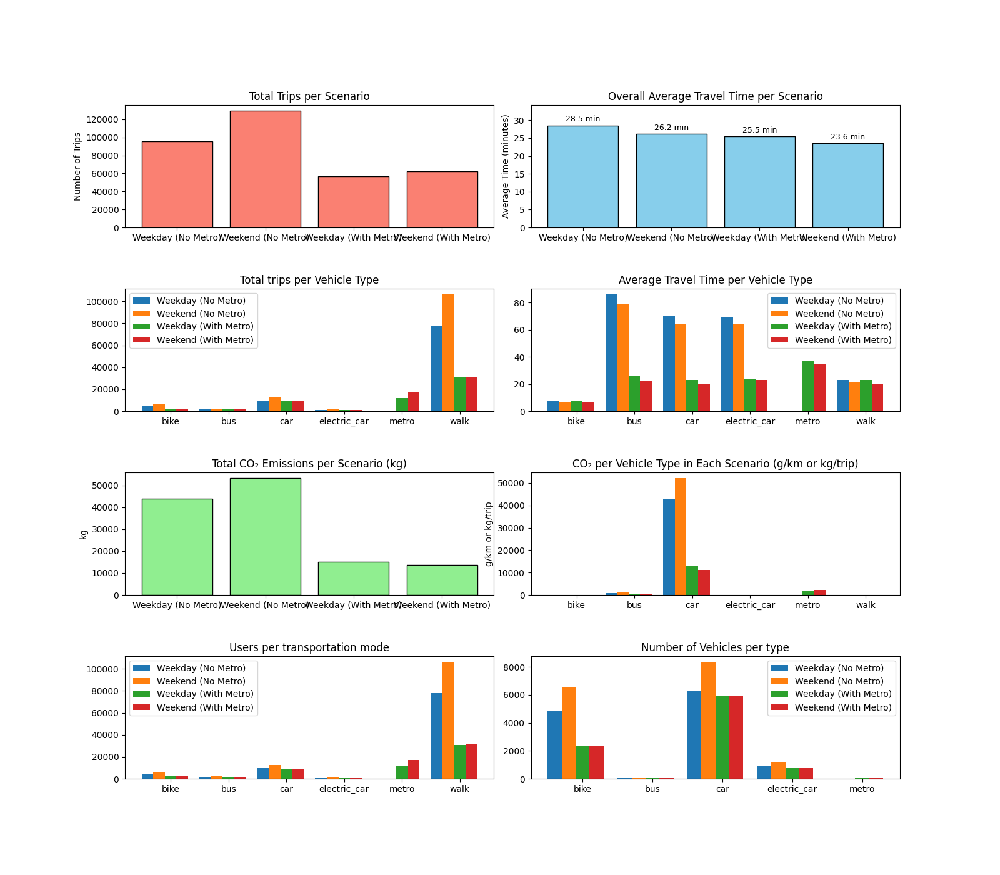

# Urban Mobility Simulation and Analysis

An object-oriented Python project that models city infrastructure, population behavior, multimodal transportation, and traffic outcomes.  
This project simulates daily movement under different policy settings (with/without metro) and compares travel efficiency and carbon emissions.

## Project Highlights

- Built a full city mobility simulation pipeline using OOP design:
  - `Location` -> `Landmark` / `Road` -> `City` -> `Person` / `Population` -> `MovementGenerator` -> `Trip` -> analytics/visualization
- Modeled realistic multimodal transport:
  - walk, bike, car, electric car, hybrid car, bus, metro
- Implemented weighted road-network pathfinding with `NetworkX` + A* (`travel_time` as edge weight)
- Added fallback routing strategy when preferred transport modes are unavailable
- Simulated traffic effects on speed and route performance
- Computed travel-time and CO2 metrics per scenario, per mode, and globally
- Produced visual reports for city map, population distribution, and scenario comparison

## Key Results (simulation)

- Simulated **5,000 agents** on a city network with **1,109 roads**
- Designed and evaluated **4 scenarios**:
  - Weekday (No Metro)
  - Weekday (With Metro)
  - Weekend (No Metro)
  - Weekend (With Metro)
- Metro-enabled outcomes (weekday):
  - Average travel time: **28.46 -> 25.69 min** (`-9.7%`)
  - Total CO2 emissions: **43.40 -> 14.98 t** (`-65.5%`)
  - Total trips: **95,278 -> 56,576** (`-40.6%`)
- Figures are taken from the saved Task 19 output in `Report_25208508.ipynb`. The simulation is stochastic, so re-runs give slightly different values.
- Demonstrated policy-level insight: transit expansion can reduce both congestion pressure and environmental impact

## Tech Stack

- Python 3
- `networkx` (graph modeling and A* pathfinding)
- `matplotlib` + `numpy` (visualization and comparative analysis)
- JSON (city/population/movement serialization)

## Repository Structure

```text
utils/
  location.py            # coordinate model + validation
  city.py                # landmark/road/city graph + metro + traffic
  population.py          # person/population models
  generate_movement.py   # daily routine movement generation + pathfinding
  vehicles.py            # vehicle hierarchy + CO2 models
  trip.py                # trip segmentation + scenario simulation + statistics
  visualisation.py       # map/population/scenario plotting
Report_25208508.ipynb    # end-to-end notebook report
task5_result.png         # city/population visualization output
task19_result.png        # simulation comparison visualization output
```

## Visual Results

### City / Population Snapshot



### Scenario Comparison Dashboard



## How to Run

Install dependencies:

```bash
pip install networkx matplotlib numpy
```

Run the full scenario simulation (uses generated city/population JSON):

```bash
python utils/trip.py
```

Run notebook report:

```bash
jupyter notebook Report_25208508.ipynb
```

## What This Project Demonstrates

- Strong OOP modeling for complex systems
- Graph algorithms applied to practical mobility planning
- Data-driven scenario analysis for decision support
- Ability to connect software engineering with sustainability metrics

